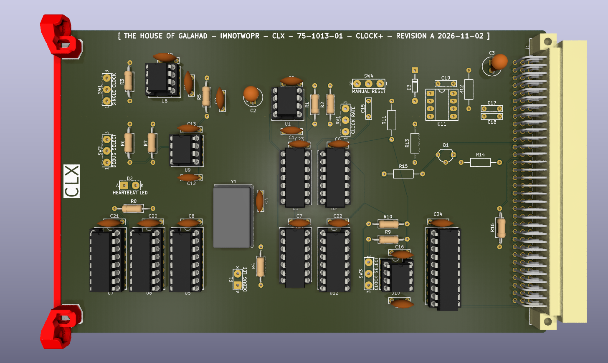
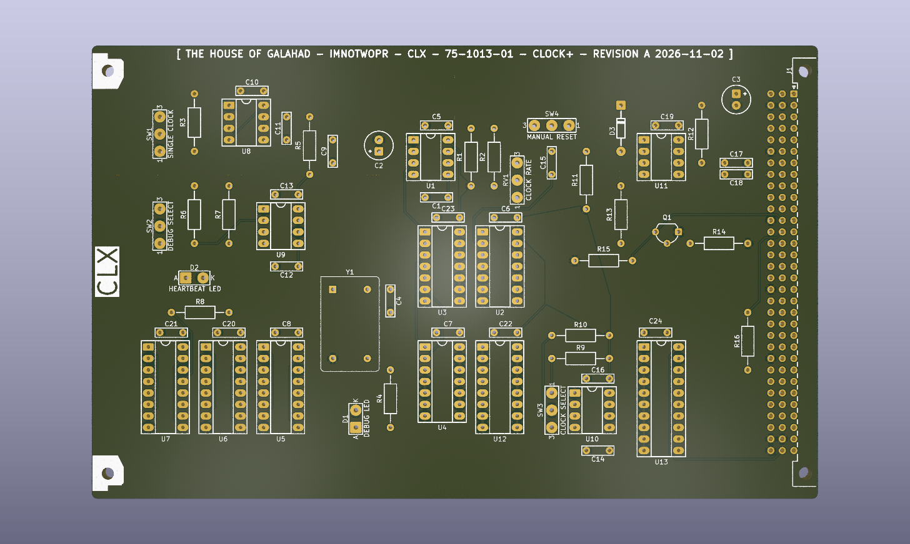
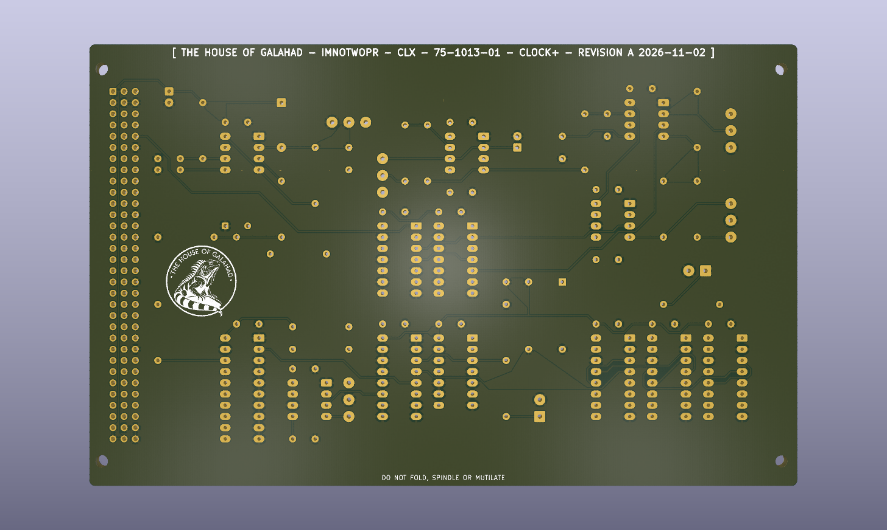

# CLX PCB

Clock+ Module PCB

Status: Untested

The **CLX (Clock+)** module supplies the IMNOTWOPR bus clock for normal operation and debugging. It combines a fixed-frequency oscillator with a 555-based test clock that can run slowly or advance one clock cycle at a time. The board operates from the backplane's +5 V supply.

The front-panel clock selector chooses which source drives the bus:

- **SYSTEM:** Uses the can-style oscillator, specified as **1 MHz** in this revision.
- **TEST:** Uses the debug clock. **AUTO** runs continuously at a speed set by the **RATE** potentiometer; the schematic specifies an approximate range of **0.7-480 Hz**. Manual operation uses the **PULSE** switch to generate individual clock pulses, allowing the processor to advance one clock cycle at a time.

The selected source passes through a 74HCT151 multiplexer and a 74AHCT541 buffer, then through a 33-ohm series resistor to the backplane's **PHI2** clock signal. The test-clock circuitry is derived from the [clock module](https://eater.net/8bit/clock) in Ben Eater's 8-bit breadboard computer.

Separate front-panel LEDs indicate system-clock and test-clock activity. Three 74HCT390 dual decade counters divide the oscillator frequency by 1,000,000 to produce a visible heartbeat: with a 1 MHz oscillator, the system-clock LED flashes at **1 Hz**, or once per second. Both indicators monitor their respective sources regardless of which source is selected to drive the bus.

### Notes

- Slow and manual clock operation requires a CPU that supports static operation, such as the **W65C02S**. A single clock pulse advances one processor clock cycle, not an entire instruction.
- Manual and power-on bus reset are normally handled by the [PWR module](../PWR/README.md). CLX retains an optional reset circuit for experimentation, but its dedicated components are marked **DNP (do not populate)**. This circuit may be removed in a later revision.

## Documents

- [Schematic](schematic.pdf)
- [Assembly](assembly.pdf)
- [Bill of Materials](bom.csv)
- [Interactive Bill of Materials](ibom.html)

## Gerber To Order

- [Default](gerber_to_order/CLX_160.0x100.0mm_for_Default.zip)
- [Elecrow](gerber_to_order/CLX_160.0x100.0mm_for_Elecrow.zip)
- [FusionPCB](gerber_to_order/CLX_160.0x100.0mm_for_FusionPCB.zip)
- [JLCPCB](gerber_to_order/CLX_160.0x100.0mm_for_JLCPCB.zip)
- [PCBWay](gerber_to_order/CLX_160.0x100.0mm_for_PCBWay.zip)

## Rendered Images

### Top 3D

### Top

### Bottom

