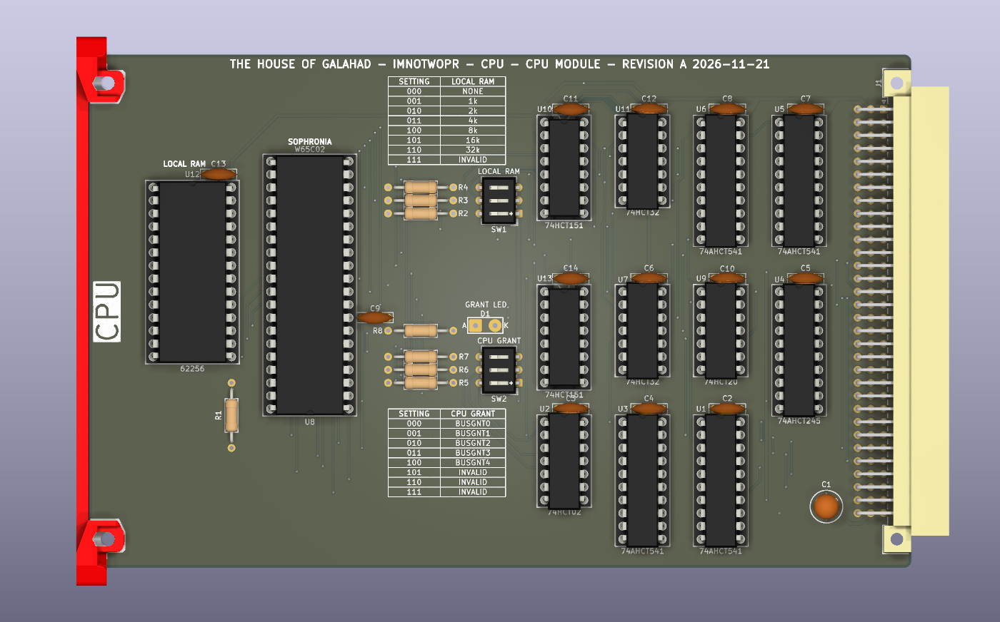
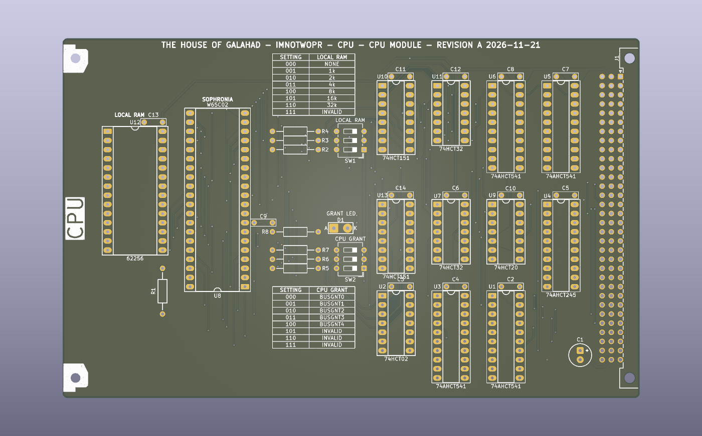
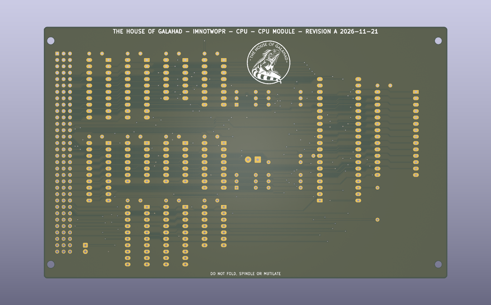

# CPU PCB

CPU Module PCB

Status: Untested

The **CPU module** provides a W65C02 processor, buffered address and data buses, and configurable local RAM for the IMNOTWOPR computer. Revision A uses a **160 mm × 100 mm Eurocard** with a **96-pin DIN 41612 backplane connector** and operates from the backplane's **+5 V** supply.

A **62256 SRAM** provides up to **32 KiB of CPU-local memory**, with a DIP switch selecting how much of the bottom of the CPU's address space it occupies. Local RAM accesses are kept off the external data bus, allowing other bus masters to use their own memory at the same addresses. The card contains no ROM; boot firmware and any additional memory or I/O must be supplied elsewhere in the system.

The CPU receives **PHI2** from the backplane, normally supplied by the [CLX module](../CLX/README.md). Reset is also supplied through the backplane, normally by the [PWR module](../PWR/README.md). Address and control buffers connect the CPU to the system bus when its selected bus-grant line is asserted. A bidirectional data transceiver handles external reads and writes, and **D1 (GRANT LED)** indicates that the card has been granted the bus.

## Configuration

The two three-position DIP switches select **local RAM size (SW1)** and **CPU bus grant (SW2)**. The tables below use the schematic's binary selection codes, written **S2 S1 S0**, with S2 as the most significant bit.

On both switches, contact pair **1–6** controls S0, **2–5** controls S1, and **3–4** controls S2. These are electrical pin pairs, not a left-to-right view of the assembled board.

**OFF = 0; ON = 1.** Each closed switch connects its selector input directly to +5 V. With the switch open, a 10 kΩ pull-down resistor holds the input at ground. R2–R4 provide the pull-downs for SW1, and R5–R7 provide them for SW2. This wiring is present in both the schematic and PCB.

With all three positions OFF, SW1 selects **no local RAM** and SW2 selects **#BUSGNT0**. For example, code `001` means S2 OFF, S1 OFF, and S0 ON; it selects 1 KiB of local RAM on SW1 or #BUSGNT1 on SW2.

### SW1 — Local RAM

| Selection (S2 S1 S0) | Local RAM | CPU address range |
| :---: | ---: | --- |
| `000` | None | All memory accesses use the system bus |
| `001` | 1 KiB | `$0000–$03FF` |
| `010` | 2 KiB | `$0000–$07FF` |
| `011` | 4 KiB | `$0000–$0FFF` |
| `100` | 8 KiB | `$0000–$1FFF` |
| `101` | 16 KiB | `$0000–$3FFF` |
| `110` | 32 KiB | `$0000–$7FFF` |
| `111` | Invalid/reserved | Do not use |

Every enabled size includes the CPU's zero page and stack. Addresses above the selected range use external memory or I/O. Local RAM is connected to the CPU side of the bus buffers and cannot be read or written by another backplane master. Its chip select is also gated by the CPU's bus grant.

For external accesses, the card asserts **#VALID** only while the CPU has the bus grant, reset is inactive, PHI2 is high, and local RAM is not selected. The same condition enables the external data transceiver. See the [bus assignment](../../doc/bus.md) for connector pin numbers; **#** denotes an active-low signal.

### SW2 — CPU Grant

| Selection (S2 S1 S0) | Selected backplane signal |
| :---: | --- |
| `000` | `#BUSGNT0` |
| `001` | `#BUSGNT1` |
| `010` | `#BUSGNT2` |
| `011` | `#BUSGNT3` |
| `100` | `#BUSGNT4` |
| `101` | Unsupported — no `#BUSGNT5` on the current bus |
| `110` | Unsupported — no `#BUSGNT6` on the current bus |
| `111` | Unsupported — no `#BUSGNT7` on the current bus |

Select the grant line assigned to this CPU by the system's bus-control configuration. That line must be driven **low** to enable the card's bus interface and local RAM; D1 lights while the grant is active. The three unsupported inputs are tied high and therefore do not grant the CPU access.

This revision does not drive the **#BUSREQ0–#BUSREQ4** lines or provide its own arbiter. The system must supply the selected grant and coordinate processor control through **READY** and **BE** when transferring bus ownership.

### System integration

- The card drives **A0–A15** and **D0–D7**. Backplane **A16–A23** are unconnected on this revision; any required upper-address levels must be established elsewhere in the system.
- **READY** connects directly to the CPU. **#IRQ**, **#NMI**, and **BE** pass through buffers enabled by the CPU grant. **R/W**, **SYNC**, **#VP**, and **#ML** are buffered onto the backplane.
- The card has no onboard clock source or clock-rate selector. Configure the system clock on the clock module.

## Documents

- [Schematic](schematic.pdf)
- [Assembly](assembly.pdf)
- [Bill of Materials](bom.csv)
- [Interactive Bill of Materials](ibom.html)

## Gerber To Order

- [Default](gerber_to_order/CPU_160.0x100.0mm_for_Default.zip)
- [Elecrow](gerber_to_order/CPU_160.0x100.0mm_for_Elecrow.zip)
- [FusionPCB](gerber_to_order/CPU_160.0x100.0mm_for_FusionPCB.zip)
- [JLCPCB](gerber_to_order/CPU_160.0x100.0mm_for_JLCPCB.zip)
- [PCBWay](gerber_to_order/CPU_160.0x100.0mm_for_PCBWay.zip)

## Rendered Images

### Top 3D

### Top

### Bottom

