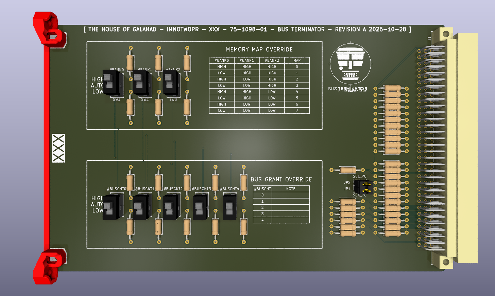
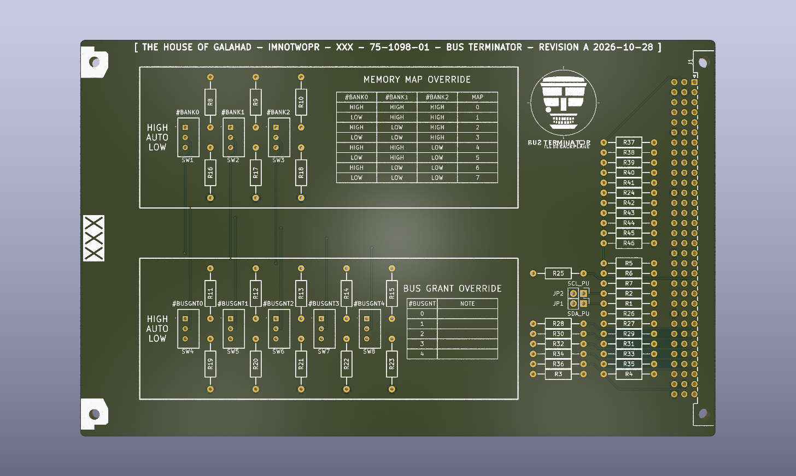
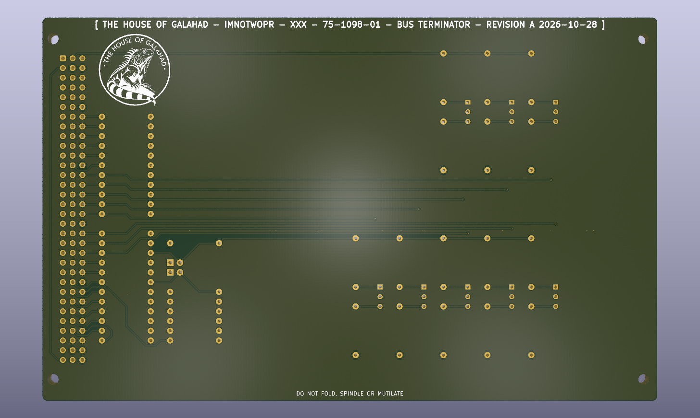

# XXX PCB

Bus Terminator/Configuration Card

Status: Untested

## Documents

- [Schematic](schematic.pdf)
- [Assembly](assembly.pdf)
- [Bill of Materials](bom.csv)
- [Interactive Bill of Materials](ibom.html)

## Gerber To Order

- [Default](gerber_to_order/XXX_160.0x100.0mm_for_Default.zip)
- [Elecrow](gerber_to_order/XXX_160.0x100.0mm_for_Elecrow.zip)
- [FusionPCB](gerber_to_order/XXX_160.0x100.0mm_for_FusionPCB.zip)
- [JLCPCB](gerber_to_order/XXX_160.0x100.0mm_for_JLCPCB.zip)
- [PCBWay](gerber_to_order/XXX_160.0x100.0mm_for_PCBWay.zip)

## Rendered Images

### Top 3D

### Top

### Bottom

