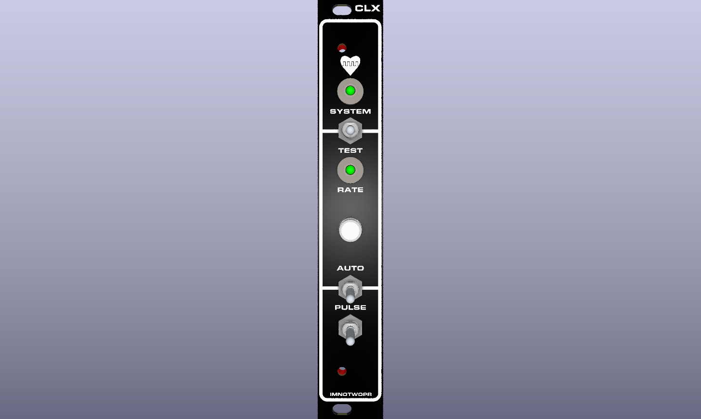
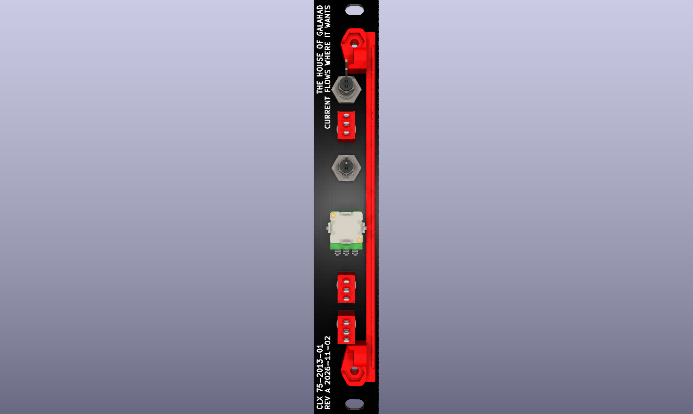

# CLX Panel

Clock+ Module Panel

Status: Untested

The **CLX (Clock+)** panel uses a PCB as the physical front panel for the [CLX clock module](../../modules/CLX/README.md). Measuring **20.0 x 128.4 mm**, it brings the module's clock controls and activity indicators to the front of the chassis, with labeled openings for the switches, rate potentiometer, and LEDs.

The **SYSTEM / TEST** selector chooses between the fixed system clock and the debug clock. In test mode, **AUTO** provides a continuous slow clock adjusted with the **RATE** control, while manual operation uses the **PULSE** switch to advance one clock cycle at a time. Separate LEDs show the system-clock heartbeat and test-clock activity, regardless of which source is selected to drive the bus.

The **RATE** control requires a **9 mm miniature potentiometer** (1 megohm, RV1 in the module schematic) to fit behind the panel. A PCB-mount version may need to be adapted for wired panel use, with leads soldered to its terminals and suitable mechanical support to secure it behind the panel.

## Gerber To Order

- [Default](gerber_to_order/CLX_20.0x128.4mm_for_Default.zip)
- [Elecrow](gerber_to_order/CLX_20.0x128.4mm_for_Elecrow.zip)
- [FusionPCB](gerber_to_order/CLX_20.0x128.4mm_for_FusionPCB.zip)
- [JLCPCB](gerber_to_order/CLX_20.0x128.4mm_for_JLCPCB.zip)
- [PCBWay](gerber_to_order/CLX_20.0x128.4mm_for_PCBWay.zip)

## Rendered Images

### Front

### Back

