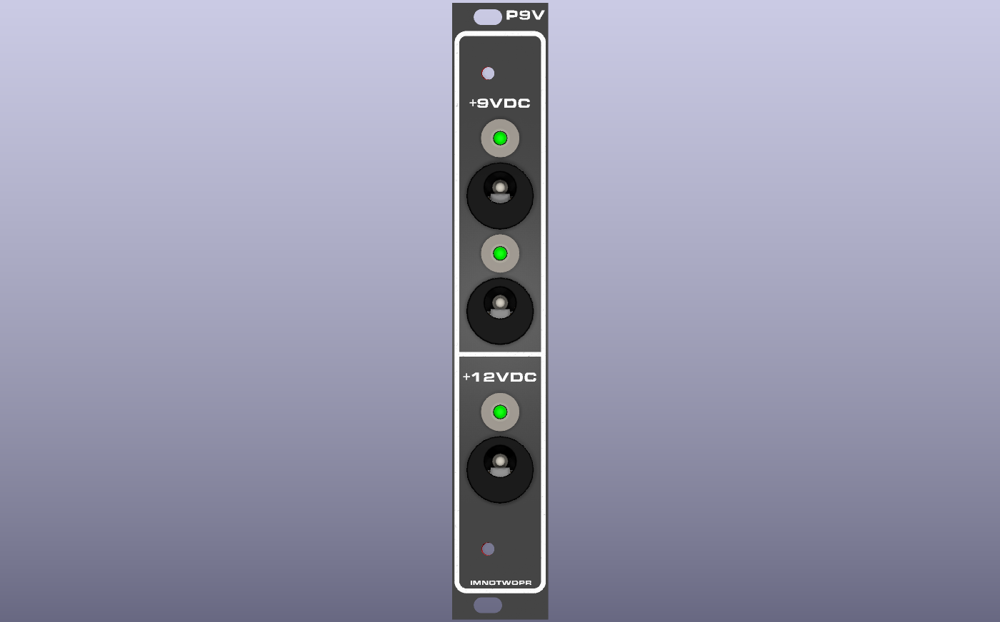
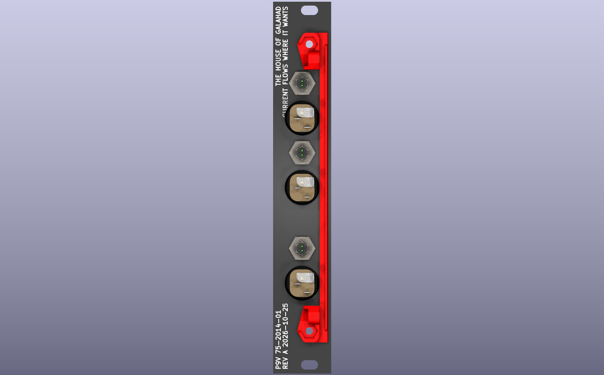

# P9V Panel

Power Supply - 4HP

The P9V panel provides power through DC barrel jacks for external components ([Lightman](../../lightman/README.md), other terminals, audio devices, etc.).  There are two independently regulated +9VDC jacks an a single +12VDC jack.  All power circuits are sourced from the +12V2 rail of the primary system power supply.

Status: Untested

## Gerber To Order

- [Default](gerber_to_order/P9V_20.0x128.4mm_for_Default.zip)
- [Elecrow](gerber_to_order/P9V_20.0x128.4mm_for_Elecrow.zip)
- [FusionPCB](gerber_to_order/P9V_20.0x128.4mm_for_FusionPCB.zip)
- [JLCPCB](gerber_to_order/P9V_20.0x128.4mm_for_JLCPCB.zip)
- [PCBWay](gerber_to_order/P9V_20.0x128.4mm_for_PCBWay.zip)

## Rendered Images

### Front

### Back

