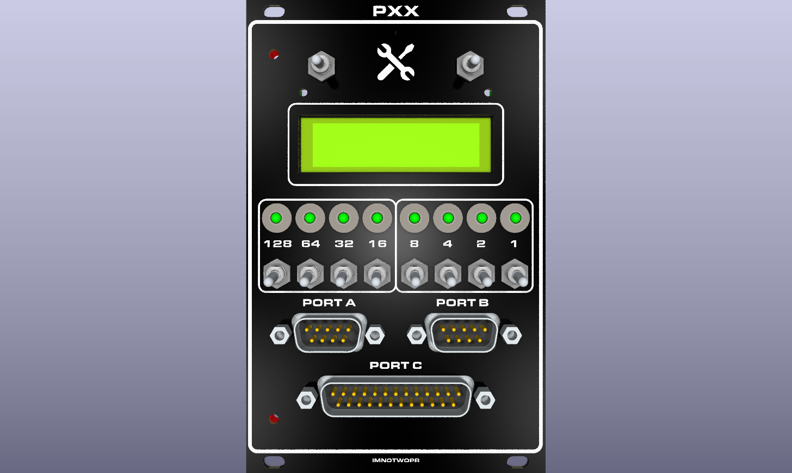
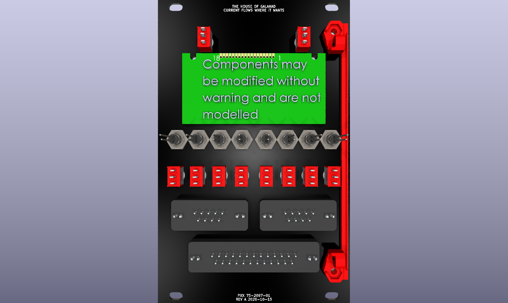

# PXX Panel

Prototype Card

This PXX prototyping panel provides space for a variety of 10-switches (on-on, on-off-on, momentary, etc.), 8 LEDs, a mini LCD panel, 2 DE-9 ports, and a single DB-25 port.  These components are not dedicated to any particular purpose.

The prototype prototype card is designed to fit a Crystalfontz [CFAH1602S-YYH-ET](https://www.crystalfontz.com/product/cfah1602syyhet-character-display-module-16x2), [CFAG12232D1-YYH-V](https://www.crystalfontz.com/product/cfag12232d1yyhvj-122x32-transflective-graphic-lcd-display), or LCD of a similar dimensions (52mm x 15mm viewing area).

Status: Untested

## Gerber To Order

- [Default](gerber_to_order/PXX_147.145894x167.915428mm_for_Default.zip)
- [Elecrow](gerber_to_order/PXX_147.145894x167.915428mm_for_Elecrow.zip)
- [FusionPCB](gerber_to_order/PXX_147.145894x167.915428mm_for_FusionPCB.zip)
- [JLCPCB](gerber_to_order/PXX_147.145894x167.915428mm_for_JLCPCB.zip)
- [PCBWay](gerber_to_order/PXX_147.145894x167.915428mm_for_PCBWay.zip)

## Rendered Images

### Front

### Back

